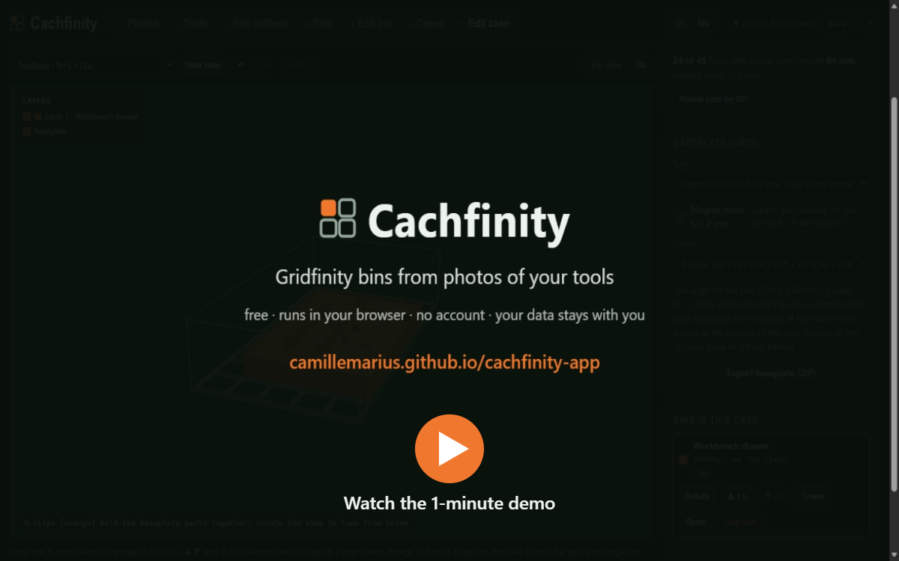

# Cachfinity

**Gridfinity bins from photos of your tools, right in the browser.** Lay your tools on a sheet of paper, take a photo, and Cachfinity traces the outlines. It then builds a bin with a pocket for every tool and exports STL for printing and STEP for CAD.

**▶ Open the app: https://camillemarius.github.io/cachfinity-app/**

Free, no account, nothing to install. Your photos and data stay in your browser.

## What it does

- **Photo to outline.** It finds the sheet of paper (A4, Letter or your own size), straightens the photo and traces every part. You can fix any point by hand, with a symmetry axis, snapping and a measuring tool.
- **Height correction.** Tall tools look larger in a photo. Give each tool its height and the outline is corrected. Photos from several directions are combined.
- **Tool library.** Every tool is kept with its outline and height. A printable **test frame** (STL, or 1:1 on paper as PDF) lets you check the fit before you print a whole bin.
- **Bins.** Each pocket follows its tool, with your choice of clearance. Tools can be dropped in by hand or **arranged compactly**, even tilted.
  - Finger scoops beside the tools make them easy to grab.
  - Lift grips let you take the bin out.
  - Magnet holes and rounded top edges are optional.
  - Bins larger than your print bed are split into parts, joined with clips.
- **Cases.** Place bins on a baseplate, stack them, and check that everything fits the case height. The baseplate itself exports too, split for your printer, with clips.
- **Exact 3D model** in the browser. Export **STL** for printing and **STEP** for CAD.
- **German and English** (switch at the top).

## How to use it

1. **Photos.** Lay the tools on white paper with some space between them and photograph them straight from above. Soft, even light works best. Then drag the four corner points onto the paper's corners if needed.
2. **Edit outlines.** Check the traced outlines, correct points where needed, and enter each tool's height.
3. **Tools.** Your library. Print a test frame for a tool when the fit matters.
4. **Bins / Edit bin.** Put tools in a bin, arrange them, add finger scoops or shapes, then export.
5. **Cases / Edit case.** Plan where the bins go and export the baseplate.

The **?** at the top explains Gridfinity and all its dimensions.

## Gridfinity compatibility

Cachfinity follows the Gridfinity standard by Zack Freedman:
- 42 mm grid, height units of 7 mm;
- the standard foot and the 4.4 mm stacking lip;
- 6 × 2 mm magnets.

Its bins fit any Gridfinity baseplate, and its baseplates take any Gridfinity bin. Half height units (e.g. 5.5 u) are possible when set by hand; they are not part of the standard.

## Your data

- Everything runs in your browser. Photos are never uploaded, and your tools, bins and cases are stored in this browser only.
- Under **Data** you can save a backup file, keep a data file in a synced folder of your own such as OneDrive (Edge and Chrome), or sync through a single file in your own Google Drive (optional).
  - Google sign-in grants access only to that one file the app creates (`drive.file`), none of your other files.
  - Your data goes directly between your browser and Google.
  - The access token is kept in memory only.
- After the first visit the app also works offline, and Edge and Chrome can install it as an app.
- No cookies, no analytics, no ads, no server of its own. The site is hosted on GitHub Pages.

## Feedback

Found a bug or have an idea? Please open an [issue](../../issues).

## Credits

[Gridfinity](https://gridfinity.xyz/) was created by Zack Freedman.

Cachfinity uses three.js, replicad / OpenCascade, Clipper and d3. Their licenses are in [THIRD_PARTY_NOTICES.md](THIRD_PARTY_NOTICES.md). This repository holds the built app for GitHub Pages.

---

**Deutsch:** Cachfinity macht aus Fotos deiner Werkzeuge Gridfinity-Bins mit passenden Taschen, ganz im Browser, kostenlos und ohne Konto. Die App gibt es auf Deutsch und Englisch (Umschalter oben). **App öffnen: https://camillemarius.github.io/cachfinity-app/**
